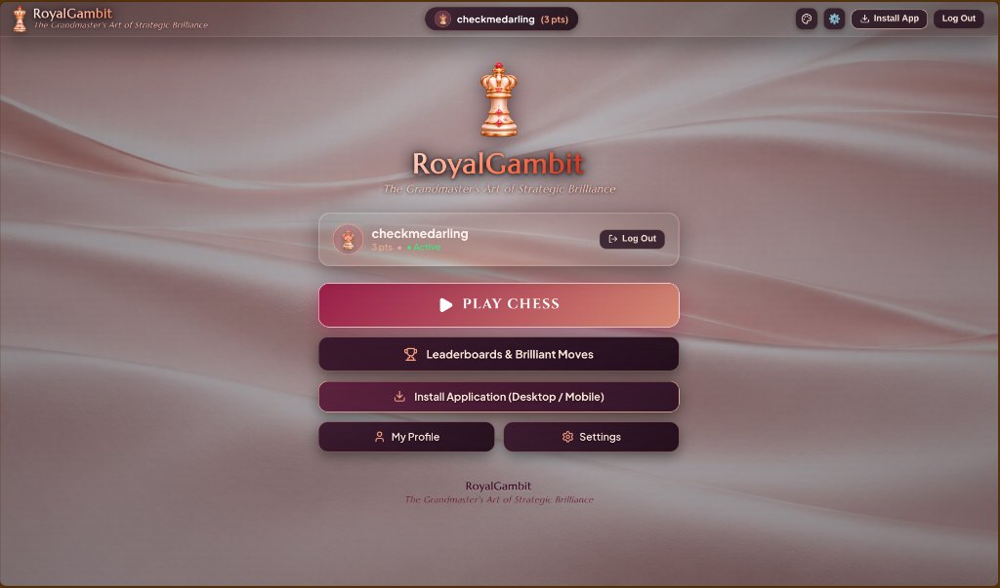
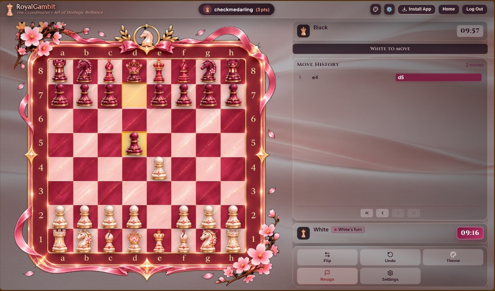
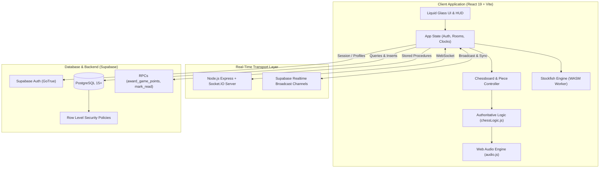
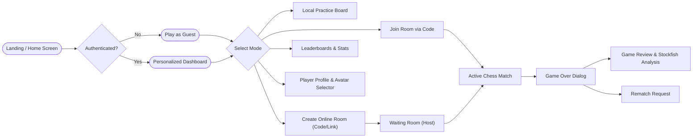
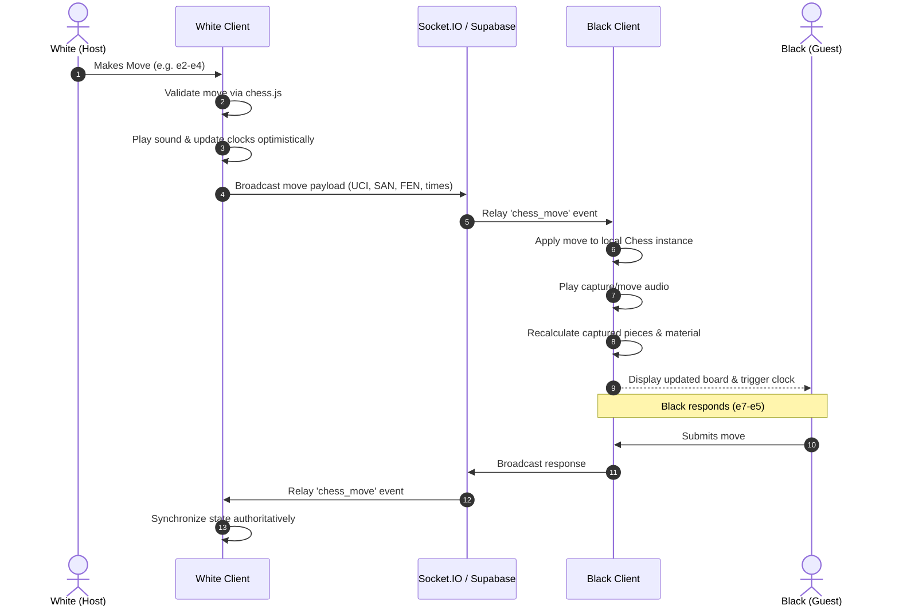

# RoyalGambit

<p align="center">
  
</p>

<p align="center">
  <strong>The Grandmaster's Art of Strategic Brilliance</strong>
</p>

<p align="center">
  <em>A luxurious, modern chess technology platform uniting Grandmaster-level precision, real-time multiplayer synchronization, WebGL Liquid Glass aesthetics, and Stockfish-powered analysis.</em>
</p>

<p align="center">
  
  
  
  
  
  
  
  
</p>

---

## Table of Contents

- [Vision & Overview](#-vision--overview)
- [Key Features](#-key-features)
  - [Authoritative Chess Engine & Rule Enforcement](#1-authoritative-chess-engine--rule-enforcement)
  - [Luxury Liquid Glass & 4 Dynamic Themes](#2-luxury-liquid-glass--4-dynamic-themes)
  - [Real-Time Multiplayer & Room Architecture](#3-real-time-multiplayer--room-architecture)
  - [Material Accounting & Multi-Queen Captured System](#4-material-accounting--multi-queen-captured-system)
  - [Stockfish Analysis & Brilliant Move Detection](#5-stockfish-analysis--brilliant-move-detection)
  - [Chess Piece Emote Avatars & Player Progression](#6-chess-piece-emote-avatars--player-progression)
- [Visual Showcase](#-visual-showcase)
- [System Architecture & Diagrams](#-system-architecture--diagrams)
  - [System Component Architecture](#system-component-architecture)
  - [User Experience & Navigation Flow](#user-experience--navigation-flow)
  - [Real-Time Multiplayer Game Flow](#real-time-multiplayer-game-flow)
- [Technology Stack](#-technology-stack)
- [Project Directory Structure](#-project-directory-structure)
- [Installation & Local Development](#-installation--local-development)
- [Environment Configuration](#-environment-configuration)
- [Vercel Deployment Guide](#-vercel-deployment-guide)
- [Supabase Integration & Database Architecture](#-supabase-integration--database-architecture)
  - [Database Schemas & RLS](#database-schemas--rls)
  - [Implemented vs. Planned Supabase Features](#implemented-vs-planned-supabase-features)
- [Security & Authentication Audit](#-security--authentication-audit)
- [Future Roadmap](#-future-roadmap)
- [Contact & Inquiries](#-contact--inquiries)
- [Licence](#-licence)

---

## Vision & Overview

**RoyalGambit** reimagines digital chess as a prestigious, luxury sporting art. Moving beyond utilitarian chess interfaces, RoyalGambit pairs tournament-grade chess engine logic with a high-fashion visual identity inspired by rose gold, ivory porcelain, ruby velvet, and champagne tones.

Built from the ground up for modern web browsers, mobile viewports, and desktop environments, RoyalGambit delivers:
- Zero-latency move rendering with optimistic updates and audio synchronization.
- Sophisticated WebGL refraction shaders using custom multi-layer Liquid Glass optics.
- Seamless multiplayer synchronization supporting both low-latency WebSockets and Supabase Realtime broadcast channels.
- Authoritative state derivation that guarantees captured-piece fidelity, material accuracy, and move legality.

---

## Key Features

### 1. Authoritative Chess Engine & Rule Enforcement
- Full FIDE rule completeness implemented through `chess.js`: legal move verification, castling (kingside and queenside), en passant, and pawn promotions (Queen, Rook, Bishop, Knight).
- Authoritative game-termination detection:
  - **Checkmate** with winning color attribution.
  - **Stalemate** (no legal moves, not in check).
  - **Threefold Repetition** detection across identical FEN positions.
  - **Insufficient Material** (K vs. K, K+B vs. K, K+N vs. K, K+B vs. K+B with same-color bishops).
  - **50-Move Rule** (no pawn move and no capture in 50 consecutive moves).
- Interactive drag-and-drop piece movement as well as click-to-move square selection with animated move hints.
- Client-side premove system: queue a move during the opponent's turn; the premove is verified against the new board state and executed instantly upon your clock start.

### 2. Luxury Liquid Glass & 4 Dynamic Themes
- Integrated WebGL multi-layer refraction, dynamic specular highlighting, and backdrop Gaussian blur.
- Instant theme switcher featuring four selectable high-resolution visual palettes:
  1. **Rose Gold Silk**: Warm satin waves, copper-rose trims, and champagne porcelain.
  2. **Pink Marble**: Polished blush stone with deep gold veining and ruby accents.
  3. **Golden Stardust**: Radiant nebulae, stardust shimmer, and burnished amber gold.
  4. **Liquid Glass**: Translucent crystalline glass panels with multi-layer caustic refractions.

### 3. Real-Time Multiplayer & Room Architecture
- **Dual-Engine Architecture**: Operates seamlessly over both an integrated Express/Socket.IO server and a cloud-native Supabase Realtime stack.
- 6-character room codes (`room_code`) for instant private matchmaking.
- One-click invite link sharing with automatic ngrok and public tunnel detection.
- Resilient reconnection handling, opponent disconnection timers, rematch requests, draw offers, and resignation dialogues.
- Integrated In-Game Chat with seen receipts (`mark_chat_messages_read`), unread badges, and 500-character sanitization.

### 4. Material Accounting & Multi-Queen Captured System
- Strict implementation of standard chess piece values:
  - **Pawn**: 1 pt
  - **Knight**: 3 pts
  - **Bishop**: 3 pts
  - **Rook**: 5 pts
  - **Queen**: 9 pts
  - **King**: 0 pts (non-capturable)
- Replays move history through an authoritative chess runner to eliminate UI counter drift.
- **Multiple Queen Support**: Accurately tracks all captured original and promoted queens (capturing two queens displays both queens with 18 points of material).
- Compact UI grouping: Multiple pieces of the same type display with multiplier badges (`×2`, `×3`) to prevent sidebar overflow.
- Dynamic net material advantage score computed from on-board pieces (`+3`, `+8`, etc.).

### 5. Stockfish Analysis & Brilliant Move Detection
- In-browser Stockfish engine running locally via WebAssembly (`stockfish.wasm`) and Web Workers.
- Move classification system evaluating every played move:
  - ‼️ **Brilliant Move**: Deep sacrifice leading to a decisive tactical advantage.
  - ⭐️ **Great Move**: Outstanding finding in a complex position.
  - 🟢 **Best / Excellent / Good**: Top engine-recommended lines.
  - 🟡 **Inaccuracy**: Slight drop in winning chances.
  - 🟠 **Mistake**: Tactically suboptimal move.
  - 🔴 **Blunder**: Critical oversight turning the game evaluation.
- Interactive Game Review modal with centipawn evaluation bar, principal variation (PV) arrows, and move-by-move navigation.

### 6. Chess Piece Emote Avatars & Player Progression
- Full-color 3D luxury piece emote avatars:
  - 👑 **Grand Queen** (`queen.png`)
  - ♚ **Royal King** (`king.png`)
  - 🏰 **Castle Rook** (`rook.png`)
  - ♘ **Noble Knight** (`knight.png`)
  - ♗ **Grand Bishop** (`bishop.png`)
  - ♟ **Valiant Pawn** (`pawn.png`)
- Public leaderboards ranking players by **Total Match Wins** and **Brilliant Moves**.
- Automated point system: Win = +3 points, Draw = +1 point, Loss = 0 points.
- Player profile modal with stats breakdown: matches played, win percentage, and custom avatar selector.

---

## 🖼 Visual Showcase

<div align="center">
  <table>
    <tr>
      <td align="center">
        
        <br />
        <strong>RoyalGambit Dashboard & Game Launcher</strong>
      </td>
      <td align="center">
        
        <br />
        <strong>Live Match HUD & Luxury Chessboard</strong>
      </td>
    </tr>
  </table>
</div>

<p align="center">
  <em>Actual application screenshots showcasing the WebGL Liquid Glass HUD, customized player card, and luxury board styling.</em>
</p>

---

## 🏛 System Architecture & Diagrams

### System Component Architecture



### User Experience & Navigation Flow



### Real-Time Multiplayer Game Flow



---

## 🛠 Technology Stack

| Layer | Technologies | Description |
|---|---|---|
| **Frontend Framework** | React 19, Vite 8, JSX | High-performance reactive UI with instant Hot Module Replacement (HMR). |
| **Chess Engine** | `chess.js` v1.4.0 | FIDE rule validation, FEN parsing, SAN generation, checkmate & draw logic. |
| **Chess Analysis** | Stockfish 16+ (WASM) | Local multi-threaded chess engine compiled to WebAssembly. |
| **Styling & Shaders** | CSS Custom Properties, Liquid Glass | WebGL refraction shader layers, glassmorphism, responsive grid layouts. |
| **Iconography** | `lucide-react` | Clean, lightweight feather icon set styled with luxury palettes. |
| **Audio Synthesis** | HTML5 Audio, Web Audio API | Low-latency audio cues with token deduplication. |
| **Backend & Sockets** | Express 5, Node.js, Socket.IO | High-concurrency room state manager and WebSocket multiplexer. |
| **Cloud Database** | PostgreSQL, Supabase JS v2 | Persistent tables, RLS security policies, and PostgreSQL triggers. |
| **Mobile & Hybrid** | Capacitor 8 | Native Android packaging and Progressive Web App (PWA) configuration. |
| **Deployment** | Vercel (Edge CDN) | Static production build with automated SPA rewrites. |

---

## 📁 Project Directory Structure

```text
royal-gambit/
├── android/                   # Capacitor Android native studio project
├── dist/                      # Production build output (Vercel deploy target)
├── public/                    # Static assets served at root
│   ├── assets/
│   │   ├── avatars/           # 6 main luxury chess piece emotes (PNG)
│   │   ├── backgrounds/       # 4 luxury theme backgrounds (WEBP & PNG)
│   │   ├── board/             # Custom chessboard frames and textures
│   │   ├── icons/             # PWA app icons (48x48 to 512x512)
│   │   ├── pieces/            # 3D rendered white & black chess pieces
│   │   ├── sounds/            # High-fidelity audio assets (move, capture, etc.)
│   │   └── theme/             # Theme wallpaper previews and thumbnails
│   ├── logo.png               # Brand crest and circular icon
│   ├── manifest.json          # PWA web manifest
│   ├── stockfish.js           # Stockfish engine runner
│   ├── stockfish.wasm         # Stockfish compiled WebAssembly binary
│   └── sw.js                  # PWA service worker with asset caching
├── src/
│   ├── components/            # React UI components
│   │   ├── AuthModal.jsx      # Login and Registration dialogue
│   │   ├── Chessboard.jsx     # Interactive 64-square chessboard
│   │   ├── GamePanel.jsx      # Match HUD, clocks, captured pieces & controls
│   │   ├── GameReviewModal.jsx# Stockfish analysis & move classifications
│   │   ├── HomeScreen.jsx     # Brand landing screen and mode launcher
│   │   ├── LeaderboardView.jsx# Wins and Brilliant Moves leaderboard tables
│   │   ├── Piece.jsx          # Individual chess piece renderer with drag support
│   │   └── ProfileModal.jsx   # Player profile, stats, and avatar picker
│   ├── lib/
│   │   ├── liquid-glass.jsx   # WebGL Liquid Glass container component
│   │   └── supabase.js        # Supabase client instantiation & config guard
│   ├── services/
│   │   ├── analysisService.js # Centipawn evaluation & brilliant move logic
│   │   ├── authService.js     # User registration, login, and profile fetching
│   │   ├── chatService.js     # Real-time chat messages and read receipts
│   │   ├── gameService.js     # Room creation, moves dispatch, and invites
│   │   └── leaderboardService.js # Queries for leaderboard rankings & user stats
│   ├── styles/
│   │   └── index.css          # Core CSS: theme definitions, typography & glass HUD
│   ├── utils/
│   │   ├── audio.js           # Audio playback system with deduplication
│   │   ├── avatars.js         # Avatar options and fallback mapper
│   │   ├── boardCoords.js     # Algebraic coordinates mapping (a1-h8)
│   │   └── chessLogic.js      # Authoritative captured pieces & material values
│   ├── App.jsx                # Main application coordinator & route controller
│   └── main.jsx               # React DOM entry point
├── supabase/
│   └── migrations/            # Versioned SQL migrations with RLS policies
│       ├── 20261103_init.sql  # Initial schema, profiles, rooms, moves, RLS
│       └── 20261103_points_and_chat_read.sql # Points system & read receipt RPCs
├── .env.example               # Safe template for environment variables
├── capacitor.config.json      # Capacitor native runtime configuration
├── LICENSE.md                 # Proprietary personal copyright licence
├── package.json               # Dependencies and build scripts
├── server.js                  # Standalone Express + Socket.IO server
├── vercel.json                # Vercel deployment and SPA routing config
└── vite.config.js             # Vite build pipeline and plugin setup
```

---

## 🚀 Installation & Local Development

### Prerequisites
- **Node.js**: v18.0.0 or higher
- **npm**: v9.0.0 or higher

### 1. Clone the Repository
```bash
git clone https://github.com/[username]/royal-gambit.git
cd royal-gambit
```

### 2. Install Dependencies
```bash
npm install
```

### 3. Configure Environment Variables
Copy the sample environment file:
```bash
cp .env.example .env
```
*(Optional)* Add your Supabase project credentials if you want cloud database persistence. If left empty, RoyalGambit will automatically function in local guest & practice mode.

### 4. Run the Development Server
```bash
# Option A: Start Vite frontend development server
npm run dev

# Option B: Build and run the full local multiplayer server
npm run build
npm start
```
The game will be available at:
- Frontend (Vite): `http://localhost:5173`
- Full Server (Express + Socket.IO): `http://localhost:3001`

---

## 🔐 Environment Configuration

Create a `.env` file in the project root based on [`.env.example`](file:///.env.example):

```bash
# Supabase Project Configuration
# Found in: Supabase Dashboard -> Project Settings -> API
VITE_SUPABASE_URL=https://your-project.supabase.co
VITE_SUPABASE_ANON_KEY=your-anon-public-key
```

> [!IMPORTANT]
> - Never place your Supabase `service_role` key in frontend `.env` files.
> - The application only requires the public **Anon key** (`VITE_SUPABASE_ANON_KEY`), which is constrained by Row Level Security (RLS) rules.

---

## ☁️ Vercel Deployment Guide

RoyalGambit is pre-configured for automated, zero-configuration deployment to **Vercel**.

### Step-by-Step Vercel Deployment

1. **Import Git Repository**: Push your code to a private GitHub repository and import it into your Vercel Dashboard.
2. **Framework Preset**: Vercel will automatically detect `Vite`.
3. **Build & Output Settings**:
   - **Build Command**: `npm run build`
   - **Output Directory**: `dist`
   - **Install Command**: `npm install`
4. **Environment Variables**: Add your production Supabase keys:
   - `VITE_SUPABASE_URL`
   - `VITE_SUPABASE_ANON_KEY`
5. **Deploy**: Click **Deploy**. Vercel will build the frontend assets, copy static files to `dist/`, and provision the edge routing defined in `vercel.json`.

---

## 🗄 Supabase Integration & Database Architecture

### Database Schemas & RLS

RoyalGambit includes production-ready database migrations in `supabase/migrations/`:

| Table | Primary Key | Description | RLS Policy Summary |
|---|---|---|---|
| `profiles` | `id (uuid -> auth.users)` | User profiles, usernames, and avatar selection. | Publicly readable; updateable only by owner (`auth.uid() = id`). |
| `game_rooms` | `id (uuid)` | Match instances, room codes, turn, clocks, and FEN. | Public read; authenticated create; participants can update. |
| `game_moves` | `id (uuid)` | Move history with UCI notation, SAN, and post-move FEN. | Public read; insertable only by verified room participants. |
| `game_messages` | `id (uuid)` | In-game chat messages and read timestamps (`read_at`). | Readable and writable only by the two players in the room. |
| `game_analysis` | `id (uuid)` | Stockfish centipawn evaluations and move classifications. | Public read; insertable by authenticated players. |
| `player_statistics`| `player_id (uuid)` | Wins, losses, draws, total points, and brilliant moves. | Public read for leaderboard; updated securely via RPC. |
| `game_invitations` | `id (uuid)` | Direct user-to-user game challenge records. | Readable by inviter and invitee. |

### Implemented vs. Planned Supabase Features

| Capability | Status | Implementation Details |
|---|---|---|
| **Supabase Auth (Sign Up / Sign In / Logout)** | ✅ Implemented | GoTrue authentication with synthetic internal email mapping. |
| **Profile & Avatar Persistence** | ✅ Implemented | Synchronized with `profiles` table and local fallbacks. |
| **Realtime Move Broadcasts** | ✅ Implemented | `chess_move` broadcast channels on room subscriptions. |
| **In-Game Chat & Seen Receipts** | ✅ Implemented | `mark_chat_messages_read` RPC function. |
| **Match Point Allocation** | ✅ Implemented | Transactional `award_game_points` RPC function (+3 win, +1 draw). |
| **Wins & Brilliant Moves Leaderboards** | ✅ Implemented | Statistical queries against `player_statistics` (strict real player records only). |
| **Stockfish Cloud Game Review Storage** | ✅ Implemented | Analysis records upserted to `game_analysis`. |
| **Automated Global Matchmaking Queue** | ⏳ Planned | Serverless lobby matching players by ELO rating brackets. |
| **Spectator Mode with Realtime Chat** | ⏳ Planned | Read-only room listeners with separate spectator chat channel. |
| **Tournament Swiss-System Brackets** | ⏳ Planned | Multi-round tournament organizer with automated scheduling. |

---

## 🔒 Security & Authentication Audit

- **Zero Plaintext Passwords**: Passwords are handled exclusively by Supabase Auth (GoTrue), which cryptographically hashes credentials using bcrypt before persistence.
- **Memory Hygiene**: Input fields for passwords in `AuthModal.jsx` are strictly wiped upon submission or modal cancellation.
- **Row Level Security (RLS)**: Direct modification of match winners or player scores from the browser is blocked. All rating updates are handled through PostgreSQL `SECURITY DEFINER` stored procedures.
- **Move Validation**: Moves cannot be forged; every move submitted must parse as legal through `chess.js` before being accepted or broadcast.
- **Content Sanitization**: Chat messages are stripped of excess whitespace, capped at 500 characters, and escaped to prevent XSS.

---

## 🗺 Future Roadmap

- [ ] **ELO Rating Algorithm**: Implement Glicko-2 / ELO calculation in PostgreSQL to replace flat point totals.
- [ ] **Global Matchmaking Queue**: Fast 1-click button to find an opponent of similar rating without sharing room codes.
- [ ] **Interactive Chess Puzzles**: Daily curated tactical puzzles powered by Stockfish.
- [ ] **Spectator Mode**: Allow friends to watch high-stakes matches in real time.
- [ ] **Mobile App Store Release**: Package Capacitor build for Google Play Store and Apple App Store.

---

## 📬 Contact & Inquiries

For official inquiries, collaborations, or feature recommendations, reach out to **Sonali Duvesh** ([@SonaliDuvesh](https://github.com/SonaliDuvesh)) or open an issue in this repository.

---

## 📜 Licence

RoyalGambit is protected under an **All Rights Reserved – Personal Proprietary Licence**.

- **Proprietary Work**: All original source code, software architecture, UI/UX designs, WebGL shaders, visual themes, custom branding ("RoyalGambit"), artwork, and audio configurations are copyright © 2026 **Sonali Duvesh**. Unauthorized reproduction, redistribution, modification, commercial exploitation, or creation of derivative works is strictly prohibited.
- **Third-Party Open-Source Components**: Third-party dependencies, libraries, engines (such as Stockfish), and fonts remain governed by their respective independent open-source licences (e.g., MIT, BSD, Apache 2.0, SIL Open Font License, GPL).
- **Public Visibility Notice**: Public availability on GitHub is solely for demonstration, inspection, and portfolio evaluation, and does not grant any permission or licence for reuse outside GitHub's standard platform terms of service.
- **Full Terms & Permissions**: For the complete legal licence, statutory clauses, and permission request procedures, please consult [`LICENSE.md`](LICENSE.md).
